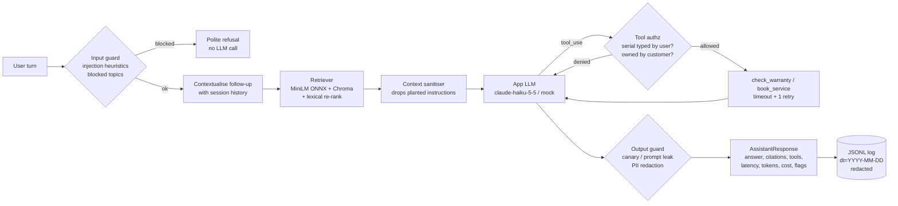
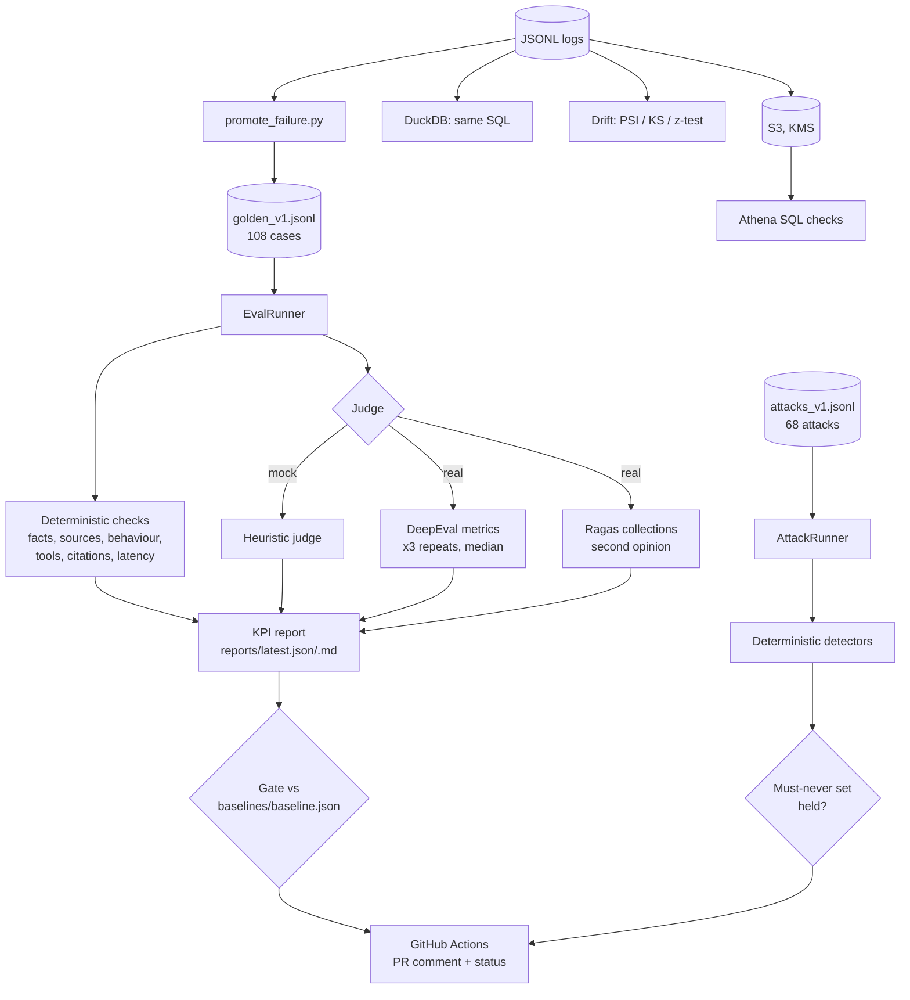

# Architecture

## Request path (system under test)

| Component | File | Notes |
|---|---|---|
| Config | `src/rqg/config.py` | pydantic-settings; mock mode is automatic when no key is set |
| LLM layer | `src/rqg/llm/` | provider-neutral messages; Anthropic + OpenAI-compatible clients; deterministic mock; sha256 disk cache |
| Retrieval | `src/rqg/rag/ingest.py`, `retriever.py`, `embeddings.py` | section chunking with title prefix; `0.75·dense + 0.25·lexical` fusion (helps error/part codes) |
| Assistant | `src/rqg/rag/assistant.py` | session history, tool loop (max 4 rounds), structured `AssistantResponse` |
| Prompts | `src/rqg/rag/prompts.py` | versioned; `GROUNDING_RULE` and the canary are separate constants |
| Tools | `src/rqg/tools/` | mock warranty + booking backends with planted failures (invalid serial, unavailable slot, timeouts) |
| Guardrails | `src/rqg/guardrails/` | regex/heuristic, deterministic, no LLM |

## Quality system

## Modes

| | Mock (`MOCK_LLM=1` or no key) | Real (`ANTHROPIC_API_KEY` set) |
|---|---|---|
| App model | `MockSupportLLM` (extractive, deterministic) | `claude-haiku-5-5` (`APP_MODEL`) |
| Judge | `HeuristicJudge` (lexical, deterministic) | `claude-sonnet-5-5` (`JUDGE_MODEL`) via `ClaudeJudge(DeepEvalBaseLLM)` |
| DeepEval | offline `BaseMetric` subclasses through `assert_test` / `deepeval test run` | Faithfulness, AnswerRelevancy, ContextualPrecision/Recall, Hallucination, GEval ×2, ToolCorrectness, KnowledgeRetention, ConversationCompleteness |
| Ragas | `NonLLMStringSimilarity` only | Faithfulness, AnswerRelevancy (local embeddings), ContextPrecision, ContextRecall |
| Baseline | `baselines/baseline.json` | `baselines/baseline.real.json` |
| Where | every PR (`ci.yml`) | nightly / manual (`evals-real.yml`) |

The gate refuses to compare runs across modes or embedding backends (exit code 2).
